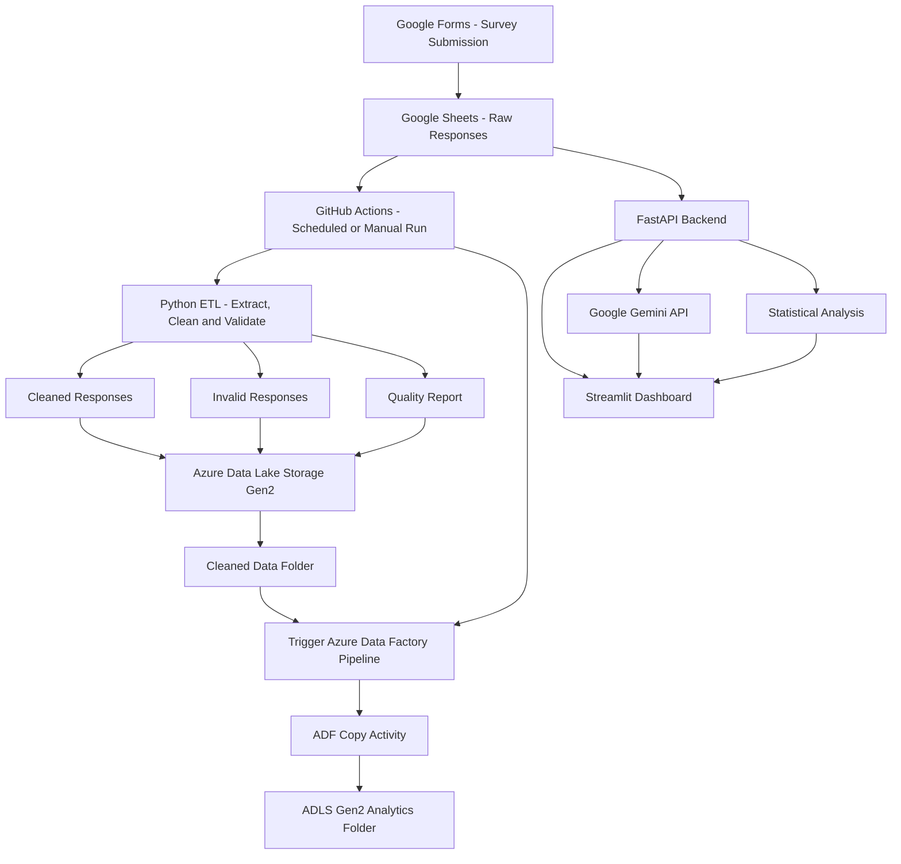
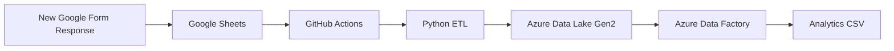

# Survey GenAI Analytics Platform

### Automated Data Engineering Pipeline with Azure and Generative AI

An end-to-end data engineering and analytics project that collects employee survey responses through Google Forms, extracts and cleans data using Python, stores processed datasets in Azure Data Lake Storage Gen2, and orchestrates data movement using Azure Data Factory.

GitHub Actions automates the cloud pipeline, while FastAPI, Streamlit, Plotly, and Google Gemini provide interactive survey analytics and AI-powered feedback insights.

**Project Status: Implemented and End-to-End Tested**

## Project Overview

Survey data often contains inconsistent values, missing information, and unstructured written feedback.

This project demonstrates how to transform raw survey responses into validated, analytics-ready data through an automated cloud data pipeline.

### Project Objectives

- Collect survey responses using Google Forms.
- Retrieve survey data from Google Sheets using Python.
- Clean, transform, and validate survey records.
- Separate valid and invalid records.
- Generate data quality reports.
- Upload processed datasets to Azure Data Lake Storage Gen2.
- Use Azure Data Factory to move cleaned data into an analytics folder.
- Automate pipeline execution using GitHub Actions.
- Provide survey analytics through FastAPI and Streamlit.
- Generate feedback insights using Google Gemini.
- Provide statistical fallback insights when Gemini is unavailable.

## Technology Stack

| Layer | Technology |
|---|---|
| Data Collection | Google Forms |
| Data Source | Google Sheets |
| Data Extraction | Google Sheets API |
| ETL Processing | Python, Pandas |
| Cloud Storage | Azure Data Lake Storage Gen2 |
| Data Orchestration | Azure Data Factory |
| Workflow Automation | GitHub Actions |
| Azure Authentication | Microsoft Entra ID, OIDC |
| Backend API | FastAPI |
| Dashboard | Streamlit |
| Visualization | Plotly |
| Generative AI | Google Gemini API |
| Testing | Pytest |
| Version Control | Git, GitHub |

## System Architecture



### Architecture Explanation

The platform consists of two workflows.

**1. Automated Cloud Data Pipeline**

Google Forms → Google Sheets → Python ETL → Azure Data Lake Storage Gen2 → Azure Data Factory → Analytics-ready CSV.

GitHub Actions executes the ETL process, uploads processed data to Azure, triggers the Azure Data Factory pipeline, and monitors its completion.

**2. Analytics Application**

Google Sheets → FastAPI → Streamlit Dashboard.

The dashboard displays survey metrics, charts, and feedback. Google Gemini generates AI insights, with statistical fallback when Gemini is unavailable.

**Important:** The current Streamlit dashboard reads survey data through FastAPI, which accesses the configured survey source. It does not directly read the final analytics CSV from Azure Data Lake.

## End-to-End Data Pipeline

### 1. Survey Data Collection

An Employee Experience & Workplace Feedback Survey was created using Google Forms.

Each submitted response is automatically recorded in the linked Google Sheet.

The survey includes information such as:

- Department or category
- Satisfaction rating
- Written feedback

Fictional survey responses are used for project testing and demonstrations.

### 2. Extract Data from Google Sheets

Python accesses Google Sheets through the Google Sheets API.

Authentication uses a Google Cloud service account with permission to read the linked spreadsheet.

The application supports a configurable survey source, including Google Sheets and local sample data.

### 3. Python ETL

The ETL process extracts, cleans, transforms, and validates survey records.

Key processing operations include:

- Extracting source data
- Standardizing survey fields
- Cleaning text values
- Validating required information
- Checking rating values
- Separating valid and invalid records
- Generating data quality information

The ETL generates the following local outputs:

```text
data/
├── sample_responses.csv
└── processed/
    ├── cleaned_responses.csv
    ├── invalid_responses.csv
    └── quality_report.json
```

**Output descriptions:**

| File | Purpose |
|---|---|
| `cleaned_responses.csv` | Valid, cleaned survey records |
| `invalid_responses.csv` | Records that fail validation |
| `quality_report.json` | ETL data quality information |

### 4. Azure Data Lake Storage Gen2

The Python automation uploads processed files to Azure Data Lake Storage Gen2.

Azure Data Lake is the storage layer for the cloud pipeline.

#### Azure Resources

| Resource | Name |
|---|---|
| Resource Group | `rg-survey-genai-dev` |
| Storage Account | `stsurveygenaidev01` |
| Storage Container | `survey-data` |
| Azure Data Factory | `adf-survey-genai-dev` |
| ADF Pipeline | `pl_survey_cleaned_to_analytics` |
| Region | North Europe |

The storage account has hierarchical namespace enabled.

### 5. Azure Data Factory

Azure Data Factory orchestrates the movement of cleaned survey data.

The pipeline is named:

`pl_survey_cleaned_to_analytics`

Its copy activity reads:

```text
survey-data/cleaned/cleaned_responses.csv
```

and writes:

```text
survey-data/analytics/cleaned_responses.csv
```

The analytics folder contains the cleaned dataset produced by the cloud pipeline.

Azure Data Factory does not store the survey data itself. The files remain in Azure Data Lake Storage Gen2.

### 6. GitHub Actions Automation

The complete cloud workflow is defined in:

```text
.github/workflows/survey-pipeline.yml
```

It performs the following steps:

1. Checks out the GitHub repository.
2. Sets up Python and installs dependencies.
3. Authenticates to Azure using GitHub OIDC.
4. Configures Google Sheets service account authentication.
5. Runs the Python ETL automation.
6. Uploads processed files to Azure Data Lake.
7. Triggers the Azure Data Factory pipeline.
8. Waits for the ADF pipeline to finish.
9. Reports success or failure.

The automation supports scheduled execution and manual execution through GitHub Actions.

**Automation behavior:** A new Google Form response is collected immediately in Google Sheets, but the ETL and Azure pipeline process it on the next scheduled run or manual workflow trigger. The current implementation does not use an instant form-submission trigger.

## FastAPI Backend

The FastAPI backend provides survey data, statistical insights, AI insights, and pipeline-related endpoints.

### Available API Endpoints

| Method | Endpoint | Purpose |
|---|---|---|
| GET | `/health` | Health check |
| GET | `/responses` | Retrieve survey responses |
| GET | `/insights` | Statistical survey insights |
| GET | `/ai-insights` | Gemini AI feedback insights |
| GET | `/debug/source` | Inspect survey source configuration |
| GET | `/etl-report` | Retrieve ETL reporting information |
| POST | `/run-etl` | Execute ETL |
| POST | `/run-pipeline` | Execute the configured pipeline workflow |

### Start FastAPI

Run from the project root:

```powershell
python -m uvicorn app.main:app --reload --port 8001
```

API documentation:

http://127.0.0.1:8001/docs

## Streamlit Analytics Dashboard

The active Streamlit dashboard is located at:

```text
app/dashboard.py
```

### Dashboard Features

- Survey response table
- Total response count
- Average satisfaction rating
- Department/category counts
- Average rating by department
- Rating distribution
- Written survey feedback
- Google Gemini AI insights
- Statistical fallback insights
- Data refresh controls

### Start Streamlit

Open a second terminal in the project root:

```powershell
python -m streamlit run app/dashboard.py
```

Open the dashboard:

http://localhost:8501

## Google Gemini AI Integration

Google Gemini analyzes written survey feedback and returns structured insights.

The analysis includes:

- Summary
- Overall sentiment
- Recurring themes
- Recommendations

The application sends survey feedback to the Gemini API and displays the returned insights in Streamlit.

## Project Structure

```text
survey-genai-analytics/
│
├── .github/
│   └── workflows/
│       ├── ci.yml
│       └── survey-pipeline.yml
│
├── app/
│   ├── __init__.py
│   ├── automation.py
│   ├── azure_storage.py
│   ├── dashboard.py
│   ├── etl.py
│   ├── gemini_analysis.py
│   └── main.py
│
├── data/
│   ├── processed/
│   │   ├── cleaned_responses.csv
│   │   ├── invalid_responses.csv
│   │   └── quality_report.json
│   └── sample_responses.csv
│
├── tests/
│   └── test_api.py
│
├── .env
├── .gitignore
├── README.md
├── requirements.txt
```

## Local Installation

### Prerequisites

- Python and Git
- VS Code or another Python editor
- Google Cloud service account with access to the survey spreadsheet
- Azure access and permissions for cloud pipeline execution
- Gemini API key for AI insights

### Step 1: Clone the Repository

```powershell
git clone https://github.com/Khushi10-DE/survey-genai-analytics.git
cd survey-genai-analytics
```

### Step 2: Create a Virtual Environment

```powershell
python -m venv .venv
```

Activate the environment in Windows PowerShell:

```powershell
.\.venv\Scripts\Activate.ps1
```

### Step 3: Install Dependencies

```powershell
python -m pip install -r requirements.txt
```

### Step 4: Configure Environment Variables

Create a local `.env` file in the project root.

Example:

```dotenv
SURVEY_SOURCE=google
GOOGLE_SHEET_ID=your_google_sheet_id
GOOGLE_APPLICATION_CREDENTIALS=C:/path/to/google-service-account.json
GEMINI_API_KEY=your_gemini_api_key
```

Replace the example values with your own configuration.

Store the Google service account JSON file outside the repository.

Never commit API keys, service account credentials, or `.env` files.

### Step 5: Start FastAPI

```powershell
python -m uvicorn app.main:app --reload --port 8001
```

### Step 6: Start Streamlit

In another terminal:

```powershell
python -m streamlit run app/dashboard.py
```

### Step 7: Open the Application

FastAPI:

http://127.0.0.1:8001/docs

Streamlit:

http://localhost:8501

## GitHub Actions Configuration

The automated cloud pipeline uses GitHub repository secrets.

### Required Secrets

| Secret | Purpose |
|---|---|
| `AZURE_CLIENT_ID` | Azure application client ID |
| `AZURE_TENANT_ID` | Microsoft Entra tenant ID |
| `AZURE_SUBSCRIPTION_ID` | Azure subscription ID |
| `GOOGLE_SHEET_ID` | Survey spreadsheet ID |
| `GOOGLE_SERVICE_ACCOUNT_JSON` | Google service account credentials |

Azure authentication uses Microsoft Entra ID and GitHub OIDC.

Google service account credentials are provided securely through GitHub Actions secrets.

## Testing and Validation

The project has been tested at the API level and through the complete cloud pipeline.

The tests cover selected FastAPI and statistical analysis functionality.

### 2. GitHub Actions CI

The CI workflow is defined in:

```text
.github/workflows/ci.yml
```
It installs project dependencies and executes the Python tests.

The CI workflow has previously completed successfully.

### 3. End-to-End Cloud Pipeline Test

The complete pipeline was tested by:

1. Submitting a new fictional response through Google Forms.
2. Confirming the response appeared in Google Sheets.
3. Running the automated GitHub Actions workflow.
4. Executing Python ETL.
5. Uploading processed data to Azure Data Lake.
6. Triggering the Azure Data Factory pipeline.
7. Checking the final analytics output.

The complete workflow was confirmed working.

### Monitoring Tests

Azure Monitor notifications were tested for both successful and failed ADF pipeline runs.

The success email was received after a successful run. The failure email was received after a deliberately failed Copy activity.

### End-to-End Test Flow



## Security

The project uses the following security practices:

- Keep API keys and credentials out of source code.
- Exclude `.env` from Git.
- Store Google service account JSON outside the repository.
- Use GitHub Actions secrets for cloud automation.
- Use GitHub OIDC for Azure authentication.
- Apply Azure role-based access control.
- Keep the Azure Data Lake container private.
- Use fictional/test data for portfolio demonstrations.
- Avoid exposing credentials or personal information in screenshots.

## Project Screenshots

The following screenshots demonstrate the automated data pipeline, Azure resources, monitoring alerts, and GenAI analytics dashboard.

| Component | Description | Screenshot |
|---|---|---|
| GitHub Actions | Successful automated Python ETL and Azure pipeline execution | [View Screenshot](docs/Screenshots/github-actions.png) |
| Azure Data Lake Gen2 | Processed datasets and analytics-ready files | [View Screenshot](docs/Screenshots/azure-data-lake.png) |
| Azure Data Factory | Successful ADF pipeline execution | [View Screenshot](docs/Screenshots/adf-pipeline.png) |
| Azure Monitor | Successful pipeline alert triggered | [View Screenshot](docs/Screenshots/success-alert.png) |
| Azure Monitor | Failed pipeline alert triggered | [View Screenshot](docs/Screenshots/failure-alert.png) |
| Success Email | Email notification received after successful pipeline execution | [View Screenshot](docs/Screenshots/success-email.png) |
| Failure Email | Email notification received after failed pipeline execution | [View Screenshot](docs/Screenshots/failure-email.png) |
| ADF Failure Test | Failed Copy activity during controlled failure testing | [View Screenshot](docs/Screenshots/adf-failure.png) |
| Streamlit Dashboard | Interactive survey analytics and visualizations | [View Screenshot](docs/Screenshots/streamlit-dashboard.png) |
| Gemini AI Insights | AI-generated feedback summaries, sentiment, themes, and recommendations | [View Screenshot](docs/Screenshots/gemini-insights.png) |

## Skills Demonstrated

### Data Engineering

- Python ETL development
- Data extraction from APIs
- Data cleaning and validation
- Data quality reporting
- Cloud data lake integration
- Azure Data Factory orchestration

### Cloud and Automation

- Azure Data Lake Storage Gen2
- Azure Data Factory
- GitHub Actions
- Scheduled workflows
- Azure SDK integration
- Microsoft Entra ID
- OIDC authentication

### Analytics and AI

- FastAPI
- Streamlit
- Plotly
- Google Gemini API
- Survey sentiment analysis
- Statistical fallback analytics

### Software Engineering

- Git and GitHub
- Python project organization
- Secure credential handling
- Pytest
- CI workflows

## Future Enhancements

Potential future improvements include:
- Triggering the pipeline immediately after each survey submission
- Incremental processing of only new survey responses
- Additional automated data quality checks
- Historical survey trend analysis
- Power BI integration
- Hosting FastAPI and Streamlit in the cloud

## Project Status

The Python ETL, automated Azure data pipeline, FastAPI backend, Streamlit dashboard, and Gemini integration are implemented.

The end-to-end pipeline has been tested successfully, and Azure Monitor email notifications have been verified for both successful and failed ADF executions.

The cloud pipeline runs through GitHub Actions and Azure. The analytics application currently runs locally.

## Repository

https://github.com/Khushi10-DE/survey-genai-analytics

---

**Project Focus:** Data Engineering | Python ETL | Azure Cloud | Automation | Generative AI Analytics
